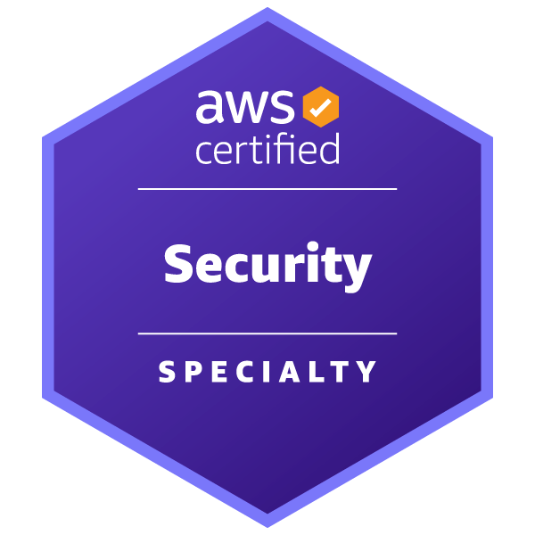
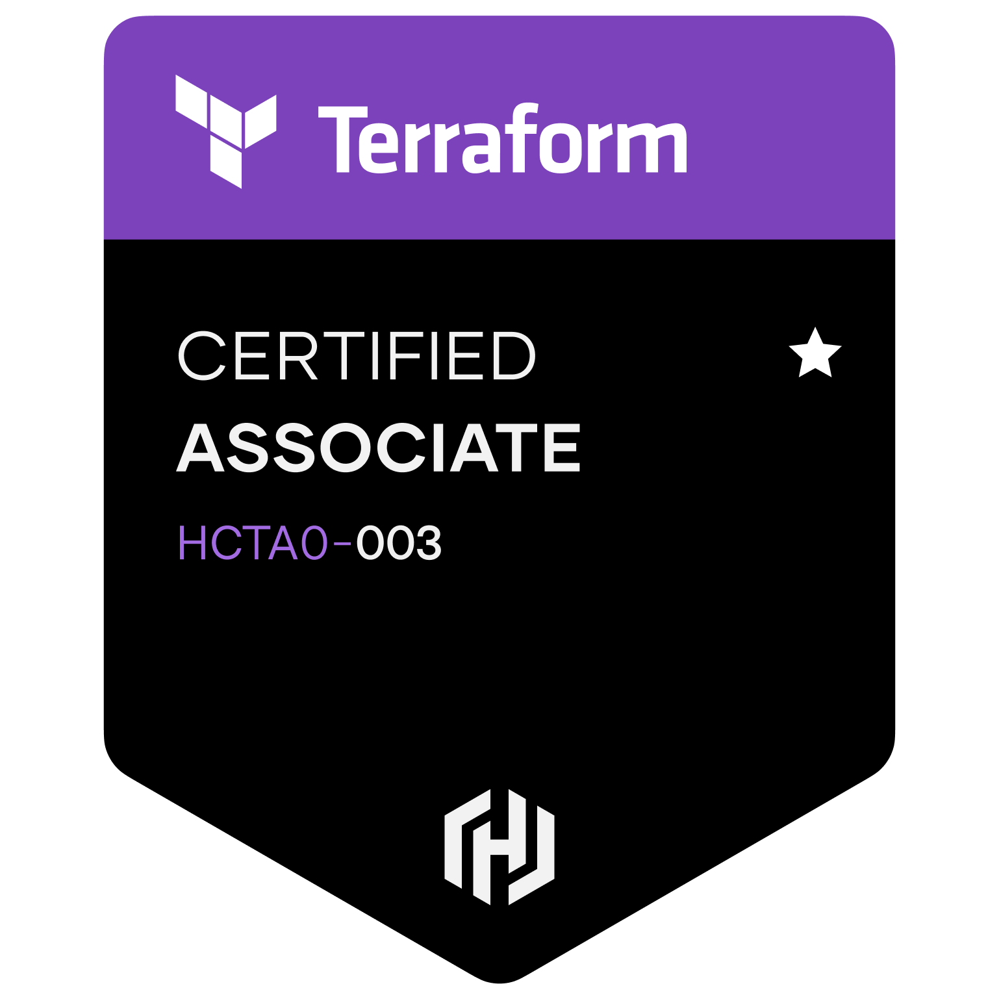
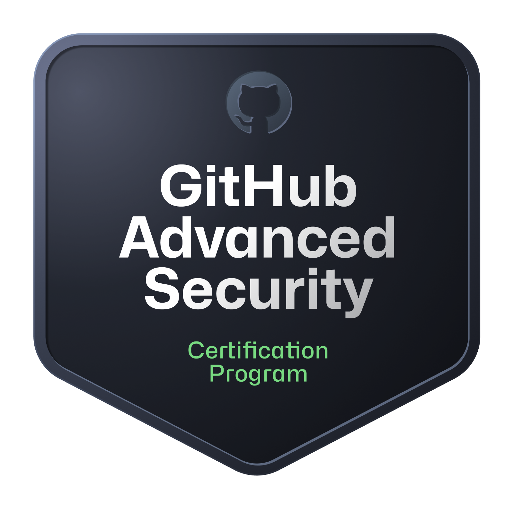

Security engineer working on cloud (AWS, GCP and Cloudflare) and mobile app security. The repos below are notes, scripts and tools from personal interests.

[][aws-solutions-architect]
[][aws-security]
[][gcp-cloud-architect]
[][terraform]
[][ghas]

[terraform]: https://developer.hashicorp.com/terraform?product_intent=terraform
[ghas]: https://github.blog/2024-01-08-github-certifications-are-generally-available/
[aws-solutions-architect]: https://aws.amazon.com/certification/certified-solutions-architect-associate/
[aws-security]: https://aws.amazon.com/certification/certified-security-specialty/
[gcp-cloud-architect]: https://cloud.google.com/learn/certification/cloud-architect

### Cloud and DevSecOps

| Repo                                                                                    | About                                                             |
| --------------------------------------------------------------------------------------- | ----------------------------------------------------------------- |
| [Cloudflare](https://github.com/rustymagnet3000/cloudflare)                             | Managing Cloudflare with Terraform.                               |
| [AWS study notes](https://github.com/rustymagnet3000/aws)                               | AWS architecture and security study notes.                        |
| [Go footguns](https://github.com/rustymagnet3000/go_footguns)                           | Subtle `Go` gotchas — one folder per finding.                     |
| [Cloudflare Worker](https://github.com/Rusty-Magnet-Ltd/cloudflare_worker)              | Serverless from Cloudflare. Powered by [Hono](https://hono.dev/). |
| [Redis](https://github.com/rustymagnet3000/redis)                                       | `redis` helpful commands and notes.                               |
| [introspection cheatsheet](https://github.com/rustymagnet3000/AppSecurityDumpingGround) | `Burp`, `cURL`, `Apache Bench`, `Bash` tips.                      |
| [Container cheatsheet](https://github.com/rustymagnet3000/container_playground)         | `Docker`, `circleCI`, `Snyk`, `Terraform` commands.               |
| [Hackerone scraper](https://github.com/rustymagnet3000/hackerone_program_scanner)       | Example of scalable HackerOne project.                            |

### Mobile security and reverse engineering

| Repo                                                                                        | About                                                                           |
| ------------------------------------------------------------------------------------------- | ------------------------------------------------------------------------------- |
| [iOS debugger challenge](https://github.com/rustymagnet3000/ios_debugger_challenge)         | Bypass anti-debug, jailbreak detection and certificate pinning in an `iOS` app. |
| [iOS debugger tips](https://github.com/rustymagnet3000/lldb_debugger)                       | `lldb` debugger commands and scripts.                                           |
| [C crackme challenges](https://github.com/rustymagnet3000/Reverse-Engineering-C-challenges) | Notes from `crackme` challenges, using `gdb`, `radare2` and `Ghidra`.           |
| [gdb cheatsheet](https://github.com/rustymagnet3000/gdb)                                    | `gdb` commands for breakpoints, watchpoints, memory and stepping.               |
| [Frida scripts](https://github.com/rustymagnet3000/frida_scripts)                           | Tiny `Frida` scripts for `iOS` and `macOS`.                                     |
| [iOS App Attest](https://github.com/rustymagnet3000/ios_devicecheck_app_attest)             | `App Attest` and `DeviceCheck` on `iOS`: how they work and their weak spots.    |
| [xOS Swizzles](https://github.com/rustymagnet3000/reverse_engineer_ios_with_swizzles)       | Reverse Engineer `iOS` or `macOS` apps at run-time.                             |
| [RSA key stealer](https://github.com/rustymagnet3000/poor_man_rsa_secret_stealer)           | `macOS` app to derive `Private Key` from a `Public Key`.                        |
